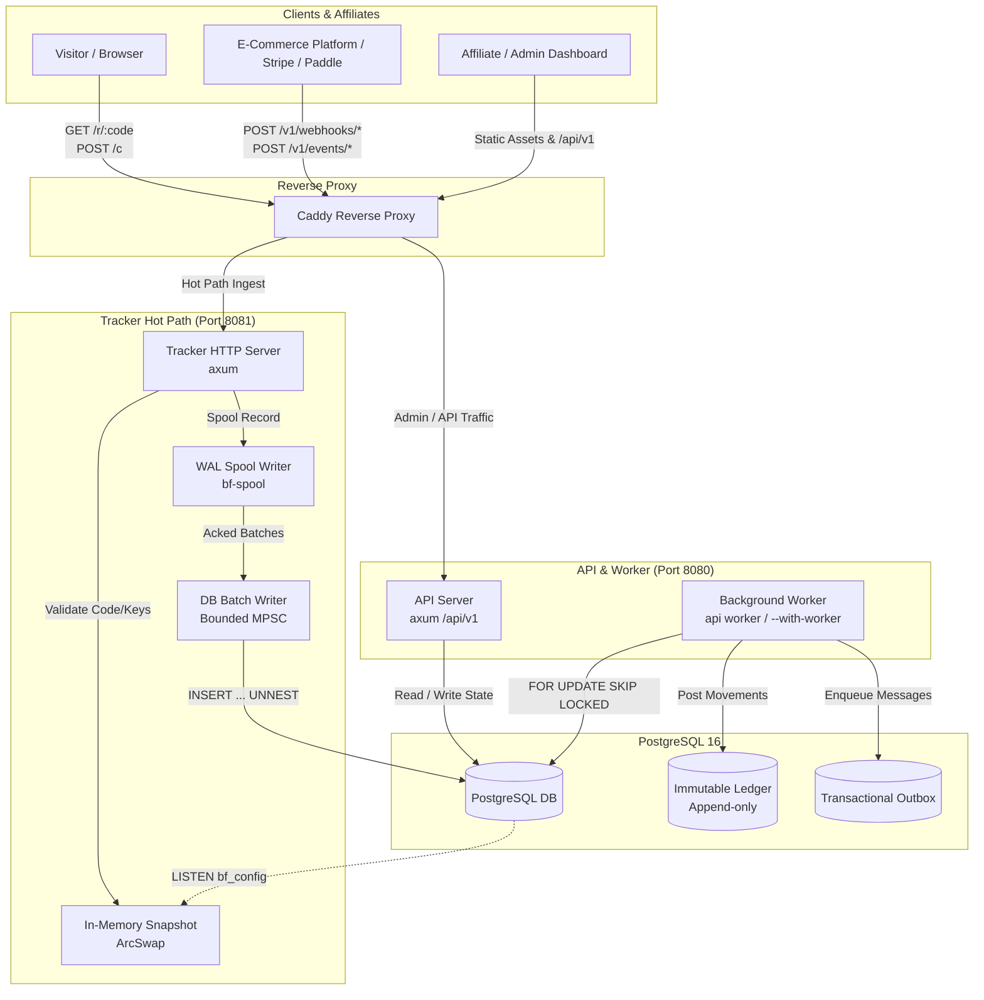

# bunfiiliate

Open-source affiliate tracking and commission engine written in Rust.

Status: **Pre-release** (active development under [`docs/PLAN.md`](docs/PLAN.md)).

Licensed under [GNU Affero General Public License v3.0 (AGPL-3.0)](LICENSE). Clean-room implementation.

---

## Why bunfiiliate?

Affiliate software is often trapped between high-cost proprietary SaaS platforms charging take-rates on GMV, and legacy monoliths that struggle with high-volume click tracking and financial reconciliation.

bunfiiliate is engineered from first principles as an open-source, self-hostable engine designed for high throughput, absolute financial correctness, and operational simplicity:

- **Sub-millisecond hot-path tracker**: Ingests clicks and conversions without touching the database during request handling. State lookups read from an in-memory `Snapshot` (`ArcSwap`) kept in sync via PostgreSQL `LISTEN`/`NOTIFY`. Events are immediately appended to a segmented Write-Ahead Log (WAL) spool with group-commit fsync.
- **Double-entry financial ledger**: Every monetary movement posts to an immutable, append-only double-entry ledger. Integer minor units (`cents: i64`) eliminate floating-point rounding errors. Deferrable PostgreSQL constraint triggers guarantee zero-sum transactional balance (`sum(amount) = 0`), and affiliate balances are strictly derived from posted transactions.
- **Multi-tenant by design**: Strict hierarchy spanning Workspaces, Programs, Affiliates, and Referral Codes with granular commission plan overrides, attribution models (first-touch and last-touch), and fraud filtering.
- **Single VPS deployment**: Two lightweight binaries (`tracker` and `api`) compiled from a clean Rust workspace, deployable as a single container image or systemd services behind Caddy.

---

## Architecture Overview



---

## Key Features

### High-Performance Ingestion Hot Path

- **Zero DB calls on hot path**: Route validation against cached in-memory snapshot (`Snapshot` in `ArcSwap`), reloaded reactively via Postgres `LISTEN bf_config`.
- **Durable WAL spool**: `bf-spool` segmented write-ahead log with CRC32 framing, configurable group-commit fsync (`always` or `off`), atomic checkpoints, and crash replay.
- **Batched DB writer**: Flushes acked spool batches over a bounded mpsc channel into PostgreSQL using `INSERT ... SELECT UNNEST(...) ON CONFLICT DO NOTHING`.
- **Load shedding**: Bounded buffers return HTTP 503 during backpressure, preventing unbounded memory growth.
- **Client tracking script**: `tracker.min.js` under 2 KB minified, managing first-party visitor cookies (`bf_vid`, `bf_ref`) and click beacons (`/c`).
- **Webhook verification**: Native constant-time HMAC signature verification for Stripe (`t=,v1=`), Paddle (`ts=;h1=`), and generic webhook payloads.

### Financial Ledger & Commission Engine

- **Pure domain core**: `bf-core` crate contains all financial models, state machines, and math without any I/O dependencies, enabling thorough proptest coverage.
- **Double-entry bookkeeping**: Explicit accounts (`Expense`, `AffPending`, `AffPayable`, `Cash`).
- **Immutable ledger**: PostgreSQL triggers reject `UPDATE` and `DELETE` on `ledger_entries`.
- **Balanced transactions**: `LedgerTxn` guarantees `sum(amount) == 0` per currency by construction and is verified by database deferrable constraint triggers.
- **Basis-point math**: Exact BPS commission calculation with round-half-up semantics evaluated in `i128`.
- **Flexible commission plans**: Flat and percentage rates, customer duration windows (`one_month`, `x_months`, `lifetime`), and program/conversion-type/affiliate override precedence.

### Multi-Tenancy & Affiliate Operations

- **Workspace isolation**: Multi-tenant separation with roles (`super_admin`, `admin`, `affiliate`) and workspace scoping on all operations.
- **Attribution strategies**: Pluggable first-touch and last-touch attribution engines.
- **Traffic hygiene & fraud rules**: IP velocity limiting, bot user-agent filtering via Woothee, visitor click deduplication, and IP hashing with salt rotation.
- **Payout workflow**: Automated payout batch generation from payable balances meeting minimum thresholds, admin approval gates, and bank/transfer CSV export.
- **Transactional outbox**: Signed outbound webhooks with exponential backoff and retry tracking, transactional email queuing via `lettre` and `minijinja`.

### Security & Authentication

- **Cookie-based sessions**: HttpOnly, `SameSite=Strict`, `Secure` JWT cookie (`bf_at`, 15-minute expiration).
- **Refresh token rotation**: Opaque refresh tokens (`bf_rt`, 30-day expiration) stored as SHA-256 hashes; detection of token reuse immediately revokes the entire token family.
- **Origin verification**: Strict origin header matching on mutating HTTP requests to prevent CSRF.
- **Password security**: Password hashing with Argon2; optional TOTP 2FA with recovery codes; rate-limited, non-enumerating password reset.
- **Secrets at rest**: webhook and provider secrets are encrypted with a rotating master key.

| Env var | Used by | Meaning |
| --- | --- | --- |
| `BF_MASTER_KEYS` / `BF_MASTER_KEY_FILE` | api, worker, tracker | `kid:base64(32B)` list, first is active (set only one) |
| `BF_ALLOW_PLAINTEXT_SECRETS` | api, tracker | dev only, default unset |
| `BF_JWT_SECRETS` | api | `kid:secret` list, first signs (legacy `JWT_SECRET` still read) |
| `BF_HSTS` | api | `1` sends HSTS |
| `BF_V1_SUNSET` | tracker | HTTP date for the v1 `Sunset` header |
| `SMTP_URL` | api | enables mail (reset, notifications) |

---

## Quickstart

### Prerequisites

- **Rust**: rustc 1.80+ (recommended via `rustup`).
- **PostgreSQL 16**: Running locally on port `5433` (port `5432` is reserved to avoid conflicts).
- **Node.js**: Node 20+ (for minifying `tracker.js` and running documentation linters).

### Toolchain Setup

On macOS arm64:

```bash
export PATH=/opt/homebrew/opt/rustup/bin:$HOME/.cargo/bin:$PATH
```

### Start PostgreSQL 16

Start the dedicated PostgreSQL 16 cluster:

```bash
/opt/homebrew/opt/postgresql@16/bin/pg_ctl -D ~/.bunfiiliate/pg16 -o "-p 5433 -k /tmp" start
```

Set the database connection string:

```bash
export DATABASE_URL=postgres://pratham@localhost:5433/postgres
```

### Validate Toolchain & Run Tests

Run the full CI test suite:

```bash
make ci
```

Or execute individual Makefile targets:

```bash
make fmt       # Format Rust codebase
make clippy    # Run clippy with -D warnings
make test      # Run all workspace unit, integration, and proptests
make deny      # Run cargo-deny dependency and license audit
```

### Bootstrap & Run

1. **Bootstrap Super Admin & Workspace**:

   ```bash
   cargo run -p api -- bootstrap \
     --email admin@example.com \
     --password "SuperSecretPassword123!" \
     --workspace "Acme Corp"
   ```

2. **Start the API Server with Embedded Worker**:

   ```bash
   cargo run -p api -- serve --with-worker
   ```

   The API server listens on port `8080` (Prometheus metrics on `9100`). OpenAPI documentation is available at `http://localhost:8080/api/openapi.json`.

3. **Start the Hot-Path Tracker**:

   ```bash
   cargo run -p tracker
   ```

   The tracker listens on port `8081` (Prometheus metrics on `9101`).

---

## Documentation

- [Architecture Guide](docs/architecture.md) — Detailed crate dependencies, tracker sequence, ledger postings, and state machines.
- [Ledger & Commission Math](docs/ledger.md) — Formal specification of double-entry postings, rounding rules, and duration windows.
- [Delivery Plan & Task DAG](docs/PLAN.md) — Complete roadmap, schema definitions, and task dependency graph.
- [Contributing Guidelines](CONTRIBUTING.md) — Git workflow, branch hygiene, commit standards, and local validation.
- [Security Policy](SECURITY.md) — Vulnerability reporting instructions, scope, and response commitments.

---

## License

This project is licensed under the [GNU Affero General Public License v3.0](LICENSE).

Optional country lookup uses the free [IP Geolocation by DB-IP](https://db-ip.com) lite database, licensed [CC BY 4.0](https://creativecommons.org/licenses/by/4.0/). Fetch it with `scripts/fetch-dbip.sh` (into the gitignored `data/`) and set `BF_GEOIP_DB`; it is never committed. `CF-IPCountry` takes priority when present.
