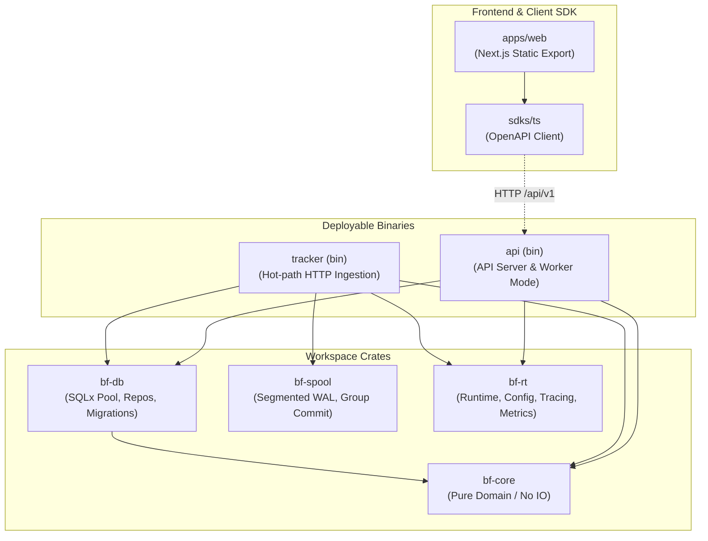
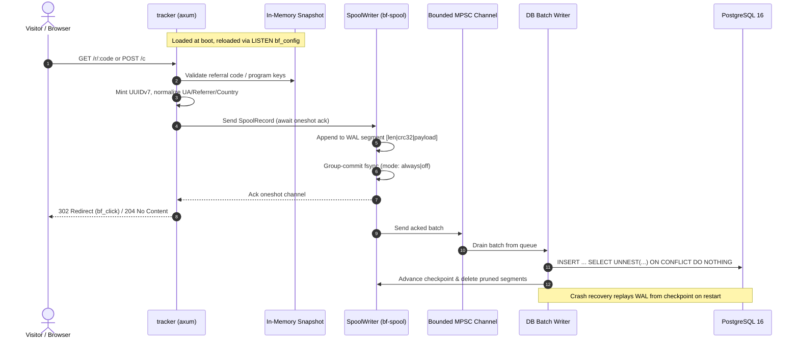
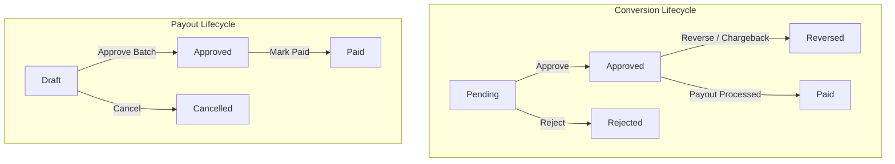

# bunfiiliate Architecture

This document details the system design, crate boundaries, data flow pipelines, financial ledger rules, and security model of bunfiiliate. All facts are derived strictly from [`docs/PLAN.md`](PLAN.md) and [`brain/architecture/`](../brain/architecture/).

---

## 1. System Layout & Crate Hierarchy

bunfiiliate is structured as a modular Rust Cargo workspace designed around a pure domain core, isolated I/O boundaries, and a crash-safe write-ahead spool.



### Crate Responsibilities

- **`bf-core`**: The pure domain engine containing no I/O dependencies. Defines `Money`, `Bps`, `Currency`, strongly typed ID newtypes, the double-entry `Account`, `Posting`, `LedgerTxn` constructors, commission math, and state machines (`ConversionStatus`, `PayoutStatus`). An optional `sqlx` feature is provided solely for Postgres enum derives.
- **`bf-db`**: Database persistence layer using SQLx. Manages PostgreSQL connections, schema migrations, repository operations, transaction management, the transactional outbox table, and advisory lock coordinators.
- **`bf-spool`**: Dedicated high-throughput segmented Write-Ahead Log (WAL). Features custom record framing `[len u32 | crc32 | json]`, group-commit async fsync routines, atomic checkpoint persistence, replay iterators with torn-tail tolerance, and automated segment garbage collection.
- **`bf-rt`**: Operational runtime support including environment-based configuration, structured `tracing` instrumentation, Prometheus metric exporters, and graceful process shutdown handlers.
- **`tracker` (bin)**: High-performance hot-path ingestion daemon (port `8081`, internal metrics `9101`). Serves `/t.js`, handles click redirects `/r/:code`, click beacons `/c`, and receives external conversion and webhook payloads.
- **`api` (bin)**: Administrative and management daemon (port `8080`, internal metrics `9100`). Provides subcommands: `serve [--with-worker]`, `worker`, `openapi`, `bootstrap`, and `seed-demo`.

### Deployables & Edge Layout

- **Two binaries, one image**: The system compiles into two binaries (`tracker` and `api`). The background worker is an execution mode of the `api` binary (`api worker` or embedded via `api serve --with-worker`), eliminating the overhead of a third binary.
- **Same-origin reverse proxy**: Caddy sits at the network edge, serving the static frontend (`apps/web`), routing `/api/v1` to the API server, and routing hot-path tracking traffic to the tracker service without requiring cross-origin resource sharing (CORS).

---

## 2. Tracker Hot Path

The tracker hot path is engineered to ingest clicks and conversion events with sub-millisecond response times by eliminating all database round-trips during request handling.



### Ingestion Pipeline Details

1. **In-Memory Snapshot Validation**: Incoming requests are validated against an in-memory `Snapshot` held in an `ArcSwap` (mapping referral codes to programs, affiliates, and landing URLs, and program keys to secrets). The snapshot reloads asynchronously upon receiving PostgreSQL `LISTEN bf_config` notifications.
2. **Metadata Normalization**: The tracker generates a time-ordered UUIDv7 event identifier in Rust, parses user-agent headers via Woothee, extracts referrers, and resolves country codes via `CF-IPCountry` headers.
3. **Group-Commit Spooling**: The event record is pushed to `SpoolWriter`, which aggregates concurrent writes into batches and executes a single `fsync` per group (when `BF_FSYNC=always`). The HTTP handler awaits a oneshot acknowledgment before returning.
4. **Asynchronous Batched Ingestion**: Acked batches are transferred over a bounded MPSC channel to a database writer task. The writer executes bulk inserts using `INSERT ... SELECT UNNEST(...) ON CONFLICT DO NOTHING` and updates the on-disk checkpoint file upon completion.
5. **Crash Recovery & Idempotency**: On process startup, uncommitted records are replayed starting from the checkpoint. Unique constraints in the database guarantee effectively-once semantics from at-least-once replay.
6. **Load Shedding**: When the internal MPSC buffer fills under extreme load, the tracker immediately sheds traffic with HTTP 503 rather than allowing unbounded memory growth.
7. **Webhook Ingestion**: Third-party webhooks (Stripe, Paddle, generic) are validated via constant-time HMAC signature checks and immediately spooled into `inbound_events`. All downstream business logic runs asynchronously within the worker.

---

## 3. Financial Ledger & Commission Engine

All monetary accounting follows strict double-entry principles. Balances are never updated in place; they are computed by aggregating posted ledger entries.

### Accounts & Posting Matrix

The ledger defines four fundamental accounts:

- **`Expense`**: Operating commission expense incurred by the merchant program.
- **`AffPending`**: Commission earned by an affiliate held in escrow pending approval or refund windows.
- **`AffPayable`**: Approved commission balance owed to the affiliate and eligible for payout.
- **`Cash`**: Actual merchant funds disbursed during settlement.

| Lifecycle Event | Debit (+) | Credit (-) | Financial Meaning |
| --- | --- | --- | --- |
| **Conversion** | `Expense` | `AffPending` | New commission generated; held pending review |
| **Approve** | `AffPending` | `AffPayable` | Hold period expires; balance becomes payable |
| **Reject / Pre-Approval Refund** | `AffPending` | `Expense` | Conversion rejected; cancels pending liability |
| **Post-Approval Chargeback** | `AffPayable` | `Expense` | Reversal of approved commission (balance may go negative) |
| **Payout Paid** | `AffPayable` | `Cash` | Funds disbursed to affiliate; clears liability |

### Double-Entry Invariants

- **Balanced by construction**: Every `LedgerTxn` comprises signed postings where debits are positive and credits are negative. The constructor verifies `sum(amount) == 0` per currency, preventing unbalanced transactions.
- **Database integrity triggers**: An `AFTER INSERT OR UPDATE OR DELETE` trigger on `ledger_entries` forbids updates and deletions. A `DEFERRABLE INITIALLY DEFERRED` constraint trigger validates that `sum(amount_cents) = 0` across each `txn_id` before commit.
- **Derived balances**: Affiliate balances are computed on demand via the `affiliate_balances` PostgreSQL database view.

### Commission Calculation & Rounding

- **Integer cents only**: All amounts are minor units (`cents: i64`). Floats are strictly prohibited.
- **Basis-point precision**: Commission rates are defined in basis points (`1 bps = 0.01%`). Percentage calculations use exact round-half-up math computed in `i128`:

  $$\text{commission} = \left\lfloor \frac{\text{amount\_cents} \times \text{rate\_bps} + 5000}{10000} \right\rfloor$$

- **Duration windows**: Commission eligibility is evaluated against whole months since customer attribution:
  - `one_month`: Commissions awarded only when `months_since_attribution == 0`.
  - `x_months(n)`: Commissions awarded when `months_since_attribution < n`.
  - `lifetime`: Commissions awarded indefinitely.

### State Machines

State transitions are modeled as pure functions returning the new status and an optional `LedgerTxn`:



---

## 4. Background Worker Architecture

The worker processes asynchronous jobs using standard `tokio` timing intervals and PostgreSQL transactional concurrency primitives.

### Processing Loops

- **Inbound Event Processing**: Polls `inbound_events` using `FOR UPDATE SKIP LOCKED`. For each event, the worker performs customer resolution, applies attribution rules (first-touch or last-touch), verifies fraud rules (`IpVelocity`, `BotUa`, `Dedupe`), calculates commissions, and records the conversion, ledger transaction, and outbox notification in a single atomic database transaction.
- **Transactional Outbox Dispatcher**: Claims pending rows from `outbox` (`FOR UPDATE SKIP LOCKED`). Dispatches signed outbound webhooks (HMAC-SHA256) with exponential backoff and delivers templated transactional emails via `lettre` and `minijinja`.
- **Periodic Ticks**: Background maintenance routines acquire PostgreSQL advisory locks via `pg_try_advisory_lock`:
  - **Auto-Approval**: Scans pending conversions whose `hold_days` have elapsed and transitions them to approved state.
  - **Daily Rollups**: Generates idempotent daily metric aggregations across clicks, conversions, revenue, and commissions partitioned by dimensions (`total`, `country`, `os`, `browser`, `device`, `referrer`).

---

## 5. Authentication & Multi-Tenancy

### Security Boundaries

```text
Workspace  --->  Programs  --->  Affiliates  --->  Referral Codes
```

- **Tenancy Scoping**: Every user belongs to a workspace (or is a global `super_admin`). Requests are validated by the `Auth<R: Role>` extractor, which enforces workspace scoping across all database queries (`Principal::workspace_scope`).
- **Session Tokens**:
  - `bf_at`: Short-lived access JWT (15-minute validity) stored in an `HttpOnly`, `SameSite=Strict`, `Secure` cookie. Contains `sub`, `role`, `ws`, and `exp`. Verified statelessly in memory without database queries.
  - `bf_rt`: Long-lived opaque refresh token (30-day validity) scoped to `/api/v1/auth`. Stored as a SHA-256 hash in `refresh_tokens`. Rotates upon every use; reuse of an expired or superseded token revokes the entire token family.
- **CSRF Protection**: All mutating HTTP requests (`POST`, `PUT`, `PATCH`, `DELETE`) require an `Origin` header matching the target host authority.
- **Password Hashes**: User credentials are encrypted using Argon2 password hashing.
